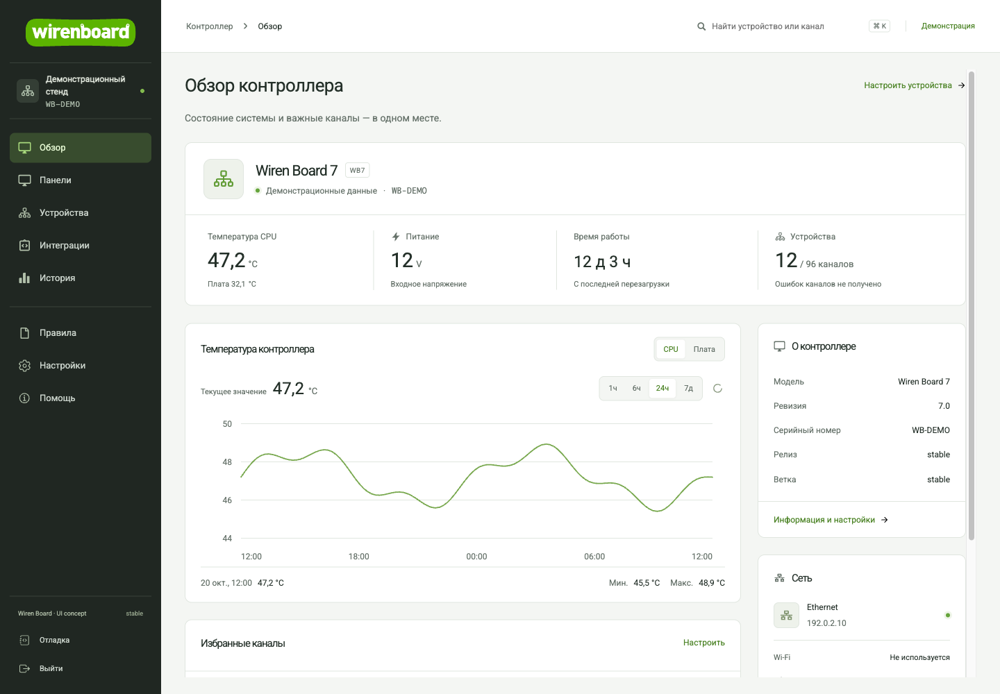
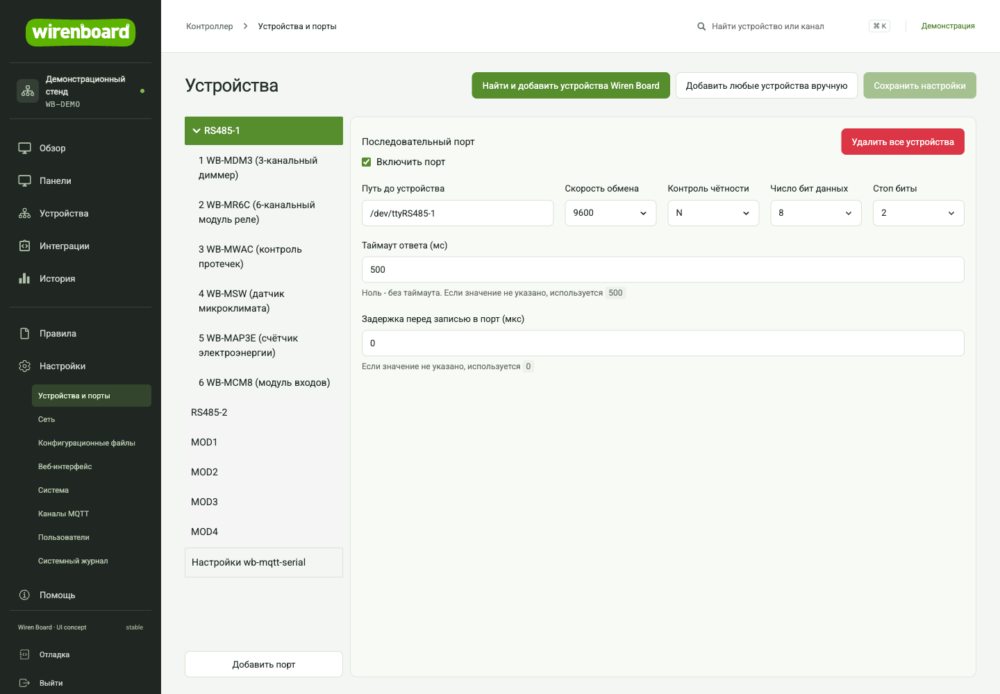
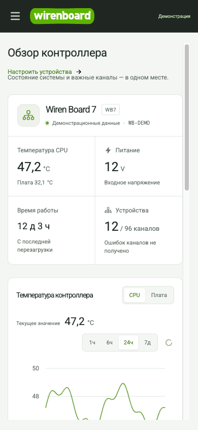

# wb-ui

**Экспериментальный интерфейс для Wiren Board.** Обзор контроллера, быстрый поиск и единое оформление штатных инструментов — в узнаваемой зелёной стилистике WB.

[](https://github.com/evstratbg/wb-ui/actions/workflows/ci.yml)
[](LICENSE)
[](https://github.com/wirenboard/homeui/tree/v2.208.1-wb100)

[Установка](#установка) · [Что изменено](#что-изменено) · [Планы](ROADMAP.md) · [Участие](CONTRIBUTING.md) · [Лицензии](#лицензии-и-авторство)



> Независимый концепт, не официальный продукт Wiren Board. Основан на полном приложении [wirenboard/homeui](https://github.com/wirenboard/homeui). Текущий этап — новая оболочка, обзор и поиск; большая часть штатных рабочих сценариев сохранена. Дальнейшая переработка ориентирована на инсталлятора: подключение, настройку и диагностику устройств. Она описана отдельно в [планах](ROADMAP.md).

## Что изменено

- Постоянная навигация, контекстная строка, поиск устройства или канала с клавиатуры (`Ctrl/Cmd + K`).
- Обзор: температура, питание, время работы, сеть, ошибки каналов и история CPU/платы.
- Избранные каналы с локальной настройкой в браузере.
- Поиск по имени устройства, MQTT ID и названиям каналов.
- Общие стили форм, таблиц, диалогов и штатных редакторов; адаптация для телефона; RU/EN для новых элементов.
- Совместимость старых SVG-панелей без поля `swipe`; нормализация `width="auto"` только при отображении, без переписывания SVG и привязок.

Внутри приложения остаются устройства и Modbus-порты, конфиги, сеть, правила, пользователи и роли, история, журналы, обычные/SVG-панели с редакторами, MQTT и установленные интеграции. Используются существующие backend, авторизация и MQTT/RPC контроллера. [Карта возможностей и проверок](deploy/CAPABILITIES.md).

<details>
<summary>Устройства и порты</summary>



</details>

<details>
<summary>Мобильный интерфейс</summary>



</details>

На публичных снимках отображаемые значения, график и идентификаторы заменены демонстрационными. В установленном интерфейсе используются данные подключённого контроллера; отдельного demo-режима в приложении нет.

## Совместимость

| Компонент | Условия |
| --- | --- |
| Основа | homeui `v2.208.1-wb100`, коммит [`0546d10`](https://github.com/wirenboard/homeui/commit/0546d10e7ade2894baa5a828549900b708ca52a8) |
| Проверено | WB7 с backend этой версии; совместимость с другими версиями отдельно не подтверждена |
| Сборка | Node.js 22, npm; версия Node указана в [.nvmrc](.nvmrc) |
| На контроллере | Статические файлы, nginx и штатные службы WB; Node.js не нужен |
| Размещение | Дополнительный HTTP-порт `8080`, штатный интерфейс остаётся на `80` |

Приложение сохраняет существующий стек AngularJS + React 18 и Webpack. Это позволяет использовать штатные редакторы и установленные API без замены backend.

## Установка

Соберите на компьютере, затем загрузите статику на контроллер. В примере замените `wirenboard.local` на его имя или IP; нужен SSH-доступ `root`.

```sh
git clone https://github.com/evstratbg/wb-ui.git
cd wb-ui/frontend

# Если используете nvm: nvm use
cp .env.concept .env
npm ci
npm test -- --runInBand
npm run build

cd ..
WB_HOST=wirenboard.local
ssh "root@${WB_HOST}" 'mkdir -p /mnt/data/wb-ui-full-staging'
scp -r frontend/dist deploy/wb-ui.conf deploy/install-on-device.sh deploy/remove-on-device.sh \
  "root@${WB_HOST}:/mnt/data/wb-ui-full-staging/"
ssh "root@${WB_HOST}" \
  'sh /mnt/data/wb-ui-full-staging/install-on-device.sh /mnt/data/wb-ui-full-staging'
```

Откройте `http://<controller>:8080/#!/overview`. Вход — существующей учётной записью WB. Корневой маршрут `/#!/` продолжает открывать настроенную домашнюю панель.

Установщик размещает версии в `/mnt/data/wb-ui/releases`, переключает `current` и добавляет `/etc/nginx/conf.d/wb-ui.conf`. При ошибке проверки или reload nginx восстанавливает прежние файлы. Рабочие конфигурации и данные общие с основным интерфейсом: сохранённые изменения применяются к реальному контроллеру.

**[Полная инструкция: требования, обновление, откат, отключение и HTTPS](deploy/README.md).** Профиль `.env.concept` отключает автоматический переход этого фронтенда на порт 443; приложенный конфиг обслуживает HTTP на 8080 и не настраивает TLS для него. Настройки HTTPS контроллера не изменяются.

Чтобы отключить дополнительный UI:

```sh
WB_HOST=wirenboard.local
ssh "root@${WB_HOST}" 'sh /mnt/data/wb-ui-full-staging/remove-on-device.sh'
```

## Разработка и проверки

```sh
cd frontend
npm ci
cp .env.concept .env
npm test -- --runInBand
npm run build
```

Для разработки настройте `MQTT_BROKER_URI` и адрес backend в webpack-конфиге под свой контроллер, затем запустите `npm start`. Dev-сервер использует реальные службы контроллера; это не изолированный симулятор. Подробности исходного проекта — в [upstream README](docs/UPSTREAM.md).

CI запускает тесты, production build и проверку синтаксиса deploy-скриптов. Артефакт `wb-ui-static` содержит сборку, установщик и лицензии; он не публикуется на контроллер автоматически.

Локально пройдены **78 тестов** и production build. На реальном WB проверялись навигация, live MQTT, история, поиск и открытие штатных редакторов на desktop/mobile. Физические выходы, сеть, пользователи и firmware при проверке не изменялись. У `tsc --noEmit` остаются 31 исходная ошибка upstream; они воспроизводятся и без изменений проекта. [Подробный объём проверки](README-UI-CONCEPT.md#проверка).

## Структура

| Каталог / файл | Содержимое |
| --- | --- |
| `frontend/src/components/navigation/` | Оболочка и навигация |
| `frontend/src/pages/overview/` | Обзор и история контроллера |
| `frontend/src/pages/devices/` | Каталог и поиск каналов |
| `frontend/app/styles/concept.css` | Общая адаптация штатных страниц |
| `frontend/test/react/concept/` | Регрессионные проверки концепта |
| `deploy/` | nginx, установка, отключение и инструкция |
| [DESIGN.md](DESIGN.md) | Визуальная система из реализованных компонентов |
| [ROADMAP.md](ROADMAP.md) | Предложенная переработка рабочих сценариев |

## Лицензии и авторство

Код проекта распространяется по **[MIT](LICENSE)** с сохранением copyright исходного homeui. Авторство изменений этого концепта: `evstratbg`. Источник и точная версия зафиксированы в [upstream reference](docs/UPSTREAM.md).

Шрифты, иконки, изображения и сторонние библиотеки сохраняют собственные условия и notices; корневая MIT-лицензия их не переопределяет. См. [THIRD_PARTY_NOTICES.md](THIRD_PARTY_NOTICES.md) и [licenses/](licenses/). Названия и логотипы Wiren Board сохраняют принадлежность правообладателям; проект не заявляет официальной аффилированности.
