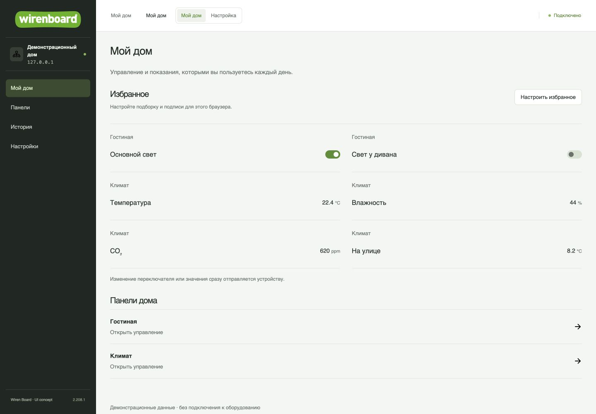

# wb-ui

**Экспериментальный интерфейс для Wiren Board.** Два рабочих режима: «Настройка» для подключения и диагностики устройств и «Мой дом» для повседневного управления.

[Установка](deploy/README.md) · [Возможности и исправления](docs/FEATURES.md) · [Разработка](docs/DEVELOPMENT.md) · [Планы](ROADMAP.md) · [Релиз-ноутс](CHANGELOG.md)

> Независимый концепт на основе [wirenboard/homeui](https://github.com/wirenboard/homeui), не официальный продукт Wiren Board. На скриншотах — демонстрационные данные; установленный UI работает с реальным контроллером.

## Что стало удобнее

- **Для инсталлятора:** каналы, настройки, история и диагностика в одной карточке устройства, с привязкой к порту и адресу.
- **Для владельца:** «Мой дом» с избранными каналами, своими подписями и готовыми панелями.
- **История:** сравнение каналов, быстрые периоды, отдельные шкалы и выгрузка CSV.
- **Настройка:** черновики с проверкой изменений, предпросмотр панелей и диагностика рядом с редактором правил.

[Сравнение «раньше / теперь», режимы, язык, исправления и скриншоты →](docs/FEATURES.md)

## Установка

Готовая сборка **[v0.2.0 · экспериментальный prerelease](https://github.com/evstratbg/wb-ui/releases/tag/v0.2.0)** устанавливается без Node.js, npm и Git на контроллере.

**[Инструкция установки →](deploy/README.md)** — готовый архив, установка без интернета, сборка из исходников, обновление, откат и отключение.

Проверено на WB7 с backend homeui `v2.208.1-wb100`. UI работает на дополнительном HTTP-порту **8080**, штатный интерфейс остаётся на **80**. Вход — существующей учётной записью WB. Режим интерфейса не меняет права доступа; сохранённые настройки применяются к реальному контроллеру.

## Документация

| Документ | Что внутри |
| --- | --- |
| [Возможности](docs/FEATURES.md) | Сценарии, преимущества, исправления и ограничения |
| [Установка](deploy/README.md) | Требования, установка, обновление, откат и отключение |
| [Разработка](docs/DEVELOPMENT.md) | Совместимость, сборка, проверки, CI и структура кода |
| [Карта возможностей](deploy/CAPABILITIES.md) | Сохранённые штатные разделы и объём проверки |
| [Планы](ROADMAP.md) · [Релиз-ноутс](CHANGELOG.md) | Реализованные сценарии и история изменений |
| [Участие](CONTRIBUTING.md) · [Дизайн](DESIGN.md) | Как предложить изменение и сохранить стиль проекта |

## Лицензии и авторство

Код проекта распространяется по **[MIT](LICENSE)** с сохранением copyright исходного homeui. Авторство изменений этого концепта: `evstratbg`. Источник и точная версия зафиксированы в [upstream reference](docs/UPSTREAM.md).

Шрифты, иконки, изображения и сторонние библиотеки сохраняют собственные условия и notices; корневая MIT-лицензия их не переопределяет. См. [THIRD_PARTY_NOTICES.md](THIRD_PARTY_NOTICES.md) и [licenses/](licenses/). Названия и логотипы Wiren Board сохраняют принадлежность правообладателям; проект не заявляет официальной аффилированности.
