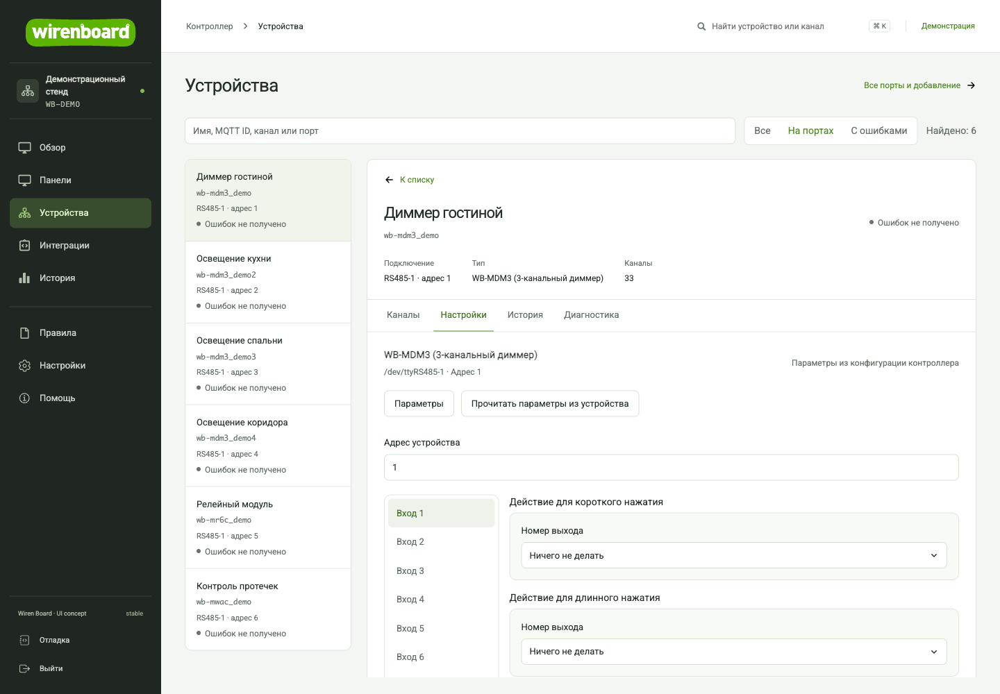
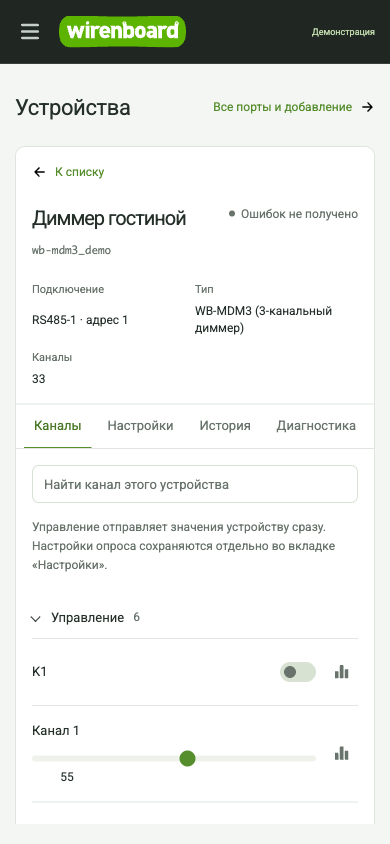

# Возможности wb-ui

[← Главная](../README.md) · [Установка](../deploy/README.md) · [Разработка](DEVELOPMENT.md)

[Режимы](#два-режима) · [Сравнение](#что-стало-удобнее) · [Устройства](#настройка-устройств) · [Панели](#панели) · [История](#история) · [Правила](#диагностика-правил) · [Исправления](#конкретные-исправления) · [Скриншоты](#скриншоты)

## Два режима

Переключатель **«Мой дом / Настройка»** находится в верхней строке на компьютере и в меню на телефоне. Выбор запоминается в этом браузере.

- **Мой дом:** избранные каналы с существующих панелей, свои подписи и порядок, обычные и SVG-панели дома, история и язык. Переключатели работают через штатные каналы WB; изменение сразу отправляет команду. При потере связи управление блокируется.
- **Настройка:** полный набор инструментов инсталлятора: устройства, порты, конфигурация, правила, журналы, сеть и системные разделы в пределах роли учётной записи.

Обычный пользователь открывает «Мой дом»; оператор и администратор могут переключаться. Режим меняет навигацию, **не права доступа**. Для передачи владельцу используйте отдельную штатную учётную запись с подходящей ролью. Избранное, его подписи и режим сохраняются локально; они не создают новые панели и не меняют конфигурацию контроллера.

Язык: меню → «Настройки» → «Веб-интерфейс» → English / Русский → «Применить». В «Моём доме» эта операция меняет только язык браузера.

## Что стало удобнее

| Задача | Раньше | Теперь |
| --- | --- | --- |
| Проверить и настроить модуль | Каналы, конфигурация портов, история и журнал в разных разделах | У выбранного устройства есть вкладки «Каналы», «Настройки», «История» и «Диагностика» |
| Найти настройки по каналу | После поиска канала нужно заново искать модуль в дереве портов | Точный MQTT ID связывает устройство с его конфигурацией и показывает порт и адрес |
| Найти нужный выход или показание | Управление и служебные каналы в общем списке | Сначала управление, затем входы и измерения; счётчики и служебные каналы свёрнуты |
| Посмотреть изменение значения | Переход в общую историю и выбор канала | История внутри устройства и общий экран сравнения: единый поиск каналов, быстрые периоды, отдельные шкалы единиц и CSV из данных |
| Разобраться с ошибкой | Сопоставление каналов, конфигурации и журнала вручную | Ошибки устройства и каналов, подключение, полученные версии firmware/bootloader и загрузка журнала драйвера рядом |
| Вернуться к найденному устройству | Поисковый контекст легко потерять при переходах | Поиск, фильтр, устройство, вкладка и канал истории в URL; ссылка на карточку и возврат к списку сохраняют контекст |
| Найти модуль без каналов | В списке MQTT ещё нечего показать | Администратор видит устройства из конфигурации портов и до получения MQTT-каналов |
| Изменить период опроса | Ручной поиск нужного канала в редакторе портов | Кнопка «Опрос» в строке канала, точное сопоставление с шаблоном и проверка общего состава изменений |
| Настроить панель | Отдельные действия могут сразу сохранять конфигурацию | Каналы → расположение → безопасный предпросмотр → явное сохранение или отмена общего черновика |
| Изменить общий виджет | Легко задеть другие панели | Явный выбор: копия только для текущей панели или изменение на всех связанных панелях |
| Найти причину ошибки правила | Переключение между кодом, консолью и журналом | Ошибка, строка сохранённого кода, живые сообщения и загрузка журнала рядом с редактором |

## Настройка устройств

Настройки открываются только при однозначном совпадении MQTT ID. При дубликатах показан конфликт; для системного, виртуального устройства или другого драйвера интерфейс сообщает об отсутствии отдельной конфигурации `wb-mqtt-serial`. Доступ к системным MQTT-устройствам по-прежнему зависит от штатной настройки их видимости.

Оператору доступны каналы, история и диагностика. Конфигурация портов, настройки и сведения о прошивке доступны администратору. Полное дерево портов, добавление устройств и штатные операции с прошивкой остаются в разделе «Все порты и добавление».

Правки настроек остаются в черновике при переходе между устройствами и вкладками. Автосохранения нет: «Сохранить» применяет **весь черновик `wb-mqtt-serial`**, включая изменения других устройств. Перед записью конфигурация повторно загружается; если она изменилась в другом окне, сохранение отменяется. Это проверка устаревших данных, а не атомарная блокировка: backend не предоставляет compare-and-swap. Обновление страницы не сохраняет черновик. Перед сохранением виден полный состав изменений. Кнопка «Опрос» доступна администратору, когда канал однозначно связан с параметрами шаблона.

Статус «Ошибок не получено» не доказывает связь с физическим модулем: backend не передаёт время его последнего ответа. Журнал загружается по запросу: до 20 записей драйвера с буквальным вхождением MQTT ID или последние записи без фильтра; не все сообщения драйвера содержат ID.

## Панели

Текстовые панели редактируются в отдельном черновике в памяти: добавление виджетов, состав каналов, порядок и предпросмотр не записывают конфигурацию. Сохранение проверяет актуальность и записывает весь Web UI config; атомарной блокировки backend нет. Общий виджет по умолчанию копируется для текущей панели. SVG-панели используют сохранённый штатный редактор.

## История

История сразу загружается при добавлении канала; быстрые периоды — 1 час, 6 часов, сутки и 7 дней. Разные единицы и типы имеют отдельные шкалы. Таблица изначально свёрнута, CSV включает все полученные точки, в том числе агрегацию backend; это не обещание выгрузки сырых измерений за любой срок. URL сохраняет каналы и даты, отменённые/устаревшие запросы не заменяют новый результат.

## Диагностика правил

Диагностика правил хранит отдельный снимок кода, к которому относится ошибка: загруженный с контроллера или отправленный при Save. Ошибка Save не обозначается как подтверждённая успешная запись. Фрагмент остаётся связан с этим снимком, а переход по строке разрешён только при совпадении текста редактора. Живые сообщения можно ограничить упоминанием файла или смотреть общий поток; записи без имени файла нельзя надёжно отнести к правилу. Журнал `wb-rules` загружается только кнопкой, до 20 записей; debug автоматически не включается.

## Что ещё изменено

- Постоянная навигация, контекстная строка, поиск устройства или канала с клавиатуры (`Ctrl/Cmd + K`).
- Обзор: температура, питание, время работы, сеть, ошибки каналов и история CPU/платы.
- Избранные каналы с локальной настройкой в браузере.
- Поиск по имени устройства, MQTT ID и названиям каналов.
- Общие стили форм, таблиц, диалогов и штатных редакторов; адаптация для телефона; RU/EN для новых элементов.

## Конкретные исправления

- Старая SVG-конфигурация без `swipe` открывается с настройками по умолчанию в памяти редактора.
- SVG с `width="auto"` нормализуется только при отображении, без переписывания исходной панели и привязок.
- Оси графика остаются читаемыми на узком экране.
- Подписи поиска находятся в правильном namespace переводов устройств.
- Сохранённая MQTT-ошибка самого устройства участвует в статусе и диагностике, даже если отдельные каналы не сообщают ошибок.
- Диапазон истории устройства учитывает разницу часов браузера и контроллера, чтобы получать актуальные точки.
- Во время сохранения и при потере связи заблокировано редактирование настроек, включая уже раскрытые выпадающие списки.

Внутри приложения остаются устройства и Modbus-порты, конфиги, сеть, правила, пользователи и роли, история, журналы, обычные/SVG-панели с редакторами, MQTT и установленные интеграции. Используются существующие backend, авторизация и MQTT/RPC контроллера. [Карта возможностей и проверок](../deploy/CAPABILITIES.md).

## Скриншоты

Рабочее место устройства

Обзор контроллера

Карточка устройства на телефоне

На публичных снимках отображаемые значения, график и идентификаторы заменены демонстрационными. В установленном интерфейсе используются данные подключённого контроллера; отдельного demo-режима в приложении нет.
